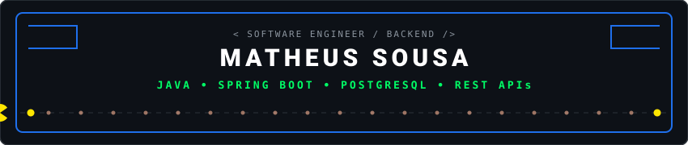

<div align="center">
  
</div>

<br/>

<div align="center">
  <a href="https://github.com/MatheusSousaa">
    
  </a>
</div>

<div align="center">
  <a href="https://www.linkedin.com/in/matheus-sousa-soares-4a240a403/" target="_blank">
    
  </a>
  <a href="mailto:matheussoousa131@gmail.com">
    
  </a>
  
</div>

<br/>

```bash
$ whoami
Matheus Sousa Soares | Estudante de Engenharia de Software
Foco: Backend com Java & Spring Boot
Status: Disponível para vagas de Estágio ou Júnior
```

### $ cat sobre-mim.md

- **Formação:** Estudando Engenharia de Software e aprofundando nos fundamentos da computação.
- **Objetivo:** Iniciar carreira no mercado de tecnologia como Estagiário ou Desenvolvedor Júnior Backend.
- **Foco técnico:** Desenvolvimento de APIs REST com Java e Spring Boot, arquitetura em camadas e persistência de dados (JPA/Hibernate, SQL e MongoDB).
- **Fundamentos:** Programação Orientada a Objetos (POO), estruturas de dados básicas, controle de versão com Git e testes de requisições com Postman.
- **Perfil:** Prático, focado em código legível e com disposição para aprender e evoluir com equipes experientes.

---

### $ ls -la /tecnologias

<div align="center">
  
  
  
  
  

  <br/>

  
  
  
  

  <br/>

  
  
  
  
  
</div>

---

### $ git status --projetos-praticos

| Repositório | Descrição | Stack |
| :--- | :--- | :--- |
| **[workshop-springboot4-jpa](https://github.com/MatheusSousaa/workshop-springboot4-jpa)** | API RESTful estruturada em camadas (Controller, Service, Repository) com persistência relacional. | `Java` `Spring Boot` `JPA/Hibernate` `H2` |
| **[workshop-springboot4-mongodb](https://github.com/MatheusSousaa/workshop-springboot4-mongodb)** | API REST com operações completas de CRUD e consultas conectadas a banco de dados NoSQL. | `Java` `Spring Boot` `MongoDB` `Spring Data` |
| **[granja-vendas-api](https://github.com/MatheusSousaa/granja-vendas-api)** | Projeto backend focado em regras de negócio para fluxo de vendas e pedidos no setor agro. | `Java` `Spring Boot` `REST API` |
| **[chess-system-java](https://github.com/MatheusSousaa/chess-system-java)** | Jogo de xadrez via console aplicando conceitos centrais de POO: herança, polimorfismo e matrizes. | `Java` `POO` `Console` |
| **[cardapio-digital](https://github.com/MatheusSousaa/cardapio-digital)** | Interface web moderna e responsiva para consulta rápida de itens e cardápios dinâmicos. | `TypeScript` `Web` `Front-end` |

---

### $ ./pacman --contribution-graph

<div align="center">
  <picture>
    <source media="(prefers-color-scheme: dark)" srcset="https://raw.githubusercontent.com/MatheusSousaa/MatheusSousaa/output/pacman-contribution-graph-dark.svg">
    <source media="(prefers-color-scheme: light)" srcset="https://raw.githubusercontent.com/MatheusSousaa/MatheusSousaa/output/pacman-contribution-graph.svg">
    
  </picture>
</div>

---

### $ ./stats

<div align="center">
  
  
</div>

<div align="center">
  
</div>

<br/>

<div align="center">
  
</div>
